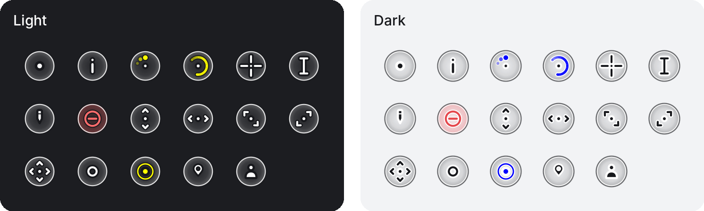
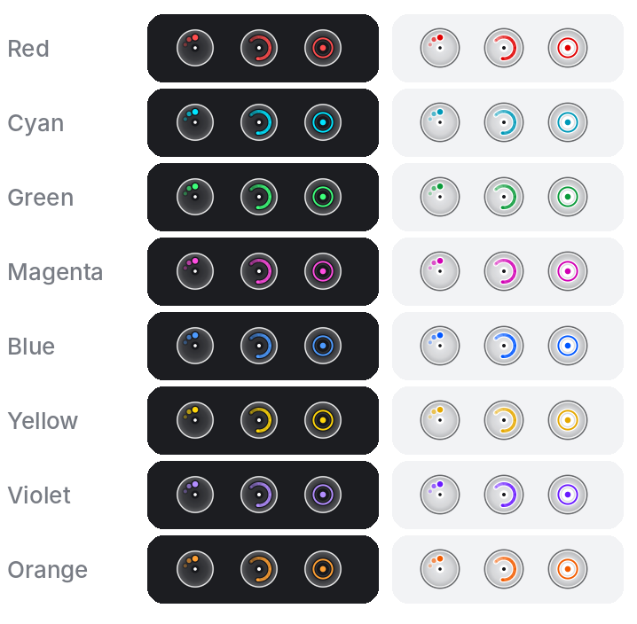

<h1 align="center">Halo Cursors</h1>

<p align="center">
  
</p>

Round, mirror-symmetric cursors for Windows and Linux, equally comfortable for left- and right-handed use.
17 cursors, two themes:

| Theme | Pointer | Accent (Working, Busy, Link) |
|-------|---------|------------------------------|
| **Light** | White, dark outline | Yellow |
| **Dark** | Dark, white outline | Blue |

Eight extra accent colors, each in Light and Dark: Red, Cyan, Green, Magenta, Blue, Yellow, Violet and Orange.

<p align="center">
  
</p>

## Windows

1. Open the `Windows` folder and double-click `Install.bat`.
2. Pick a theme, an accent color and, if you want, a pointer size.

Alternatively, open `Light` or `Dark` (or a folder inside `Colors`), right-click `Install.inf` and choose **Install**,
then click **OK** in the Mouse window that opens.

To go back, double-click `Restore.bat`.

### Pointer size

Every cursor file holds several sizes and Windows picks one automatically. To change it:

- **Windows 11:** Settings > Accessibility > Mouse pointer and touch > Size
- **Windows 10:** Settings > Ease of Access > Cursor & pointer > Change pointer size
- **Install.bat:** it also asks for a size from 1 to 15

Cursors stay sharp up to 128 px (size 7 at 100% display scale); Working in background up to 96 px (size 5) and Busy up to 64 px (size 3).

## Linux

Works on Plasma, GNOME, XFCE, Cinnamon and COSMIC (Xcursor themes).

```sh
cd Linux
./install.sh Light          # or Dark
./install.sh Dark Red       # with an accent color
```

It installs the theme for your user and applies it. If the cursor does not change, log out and back in;
on COSMIC you may need to pick Halo in Settings > Desktop > Appearance.
To install by hand, copy a `Halo-*` folder to `~/.local/share/icons` and select it in your desktop settings.

## Source

`tools/generate.py` regenerates everything (`python3 tools/generate.py OUTPUT_DIR`; needs Python 3, Pillow, NumPy and `rsvg-convert`).
